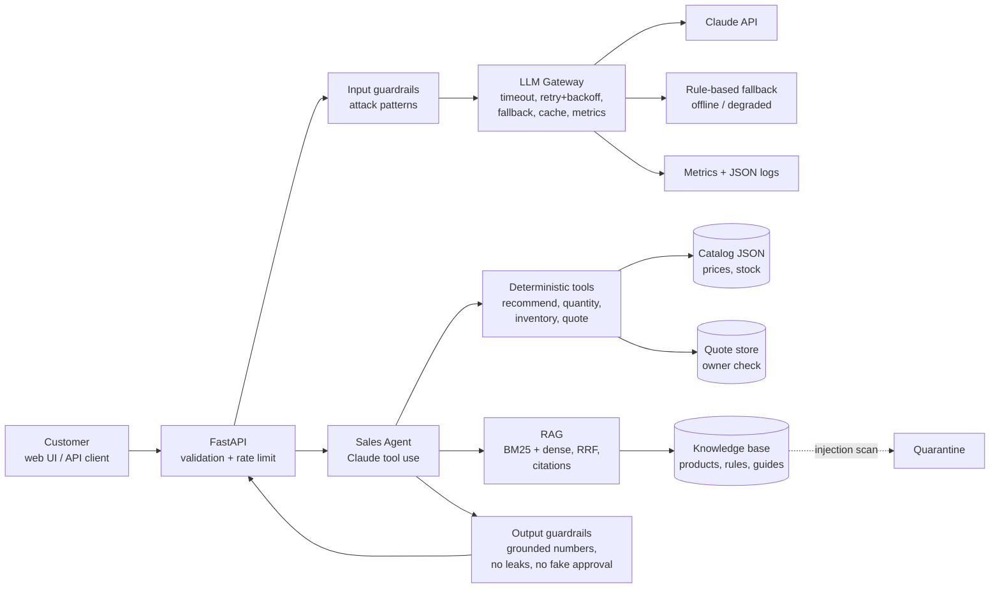
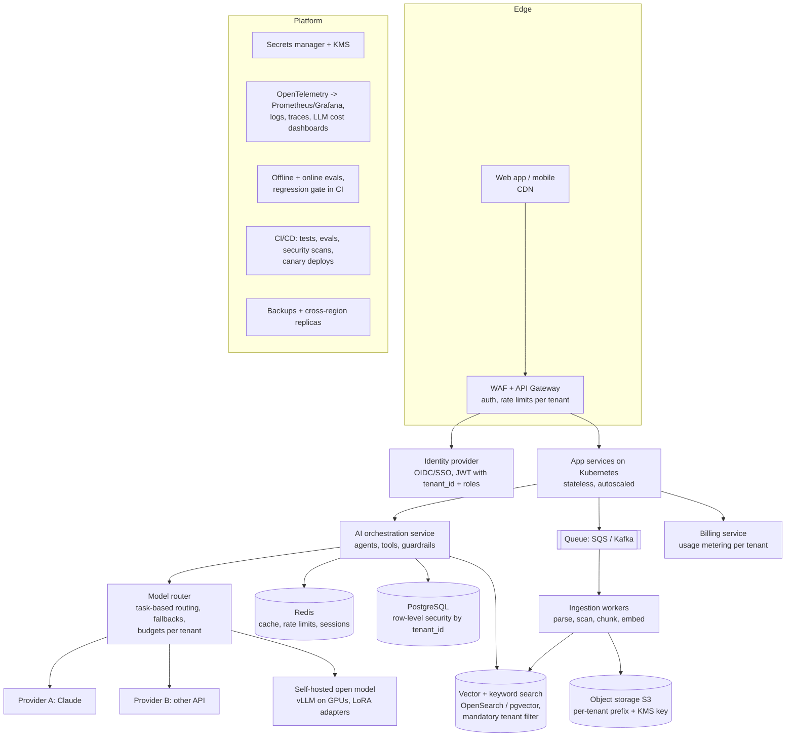

# Architecture

## 1. What is built in this repository

**Key separation (E.13)**

| Belongs in | What | Why |
|---|---|---|
| Model behaviour (prompt + LoRA) | tone, asking targeted questions, refusing unsafe requests, JSON format, using the facts it is given | stable behaviour, rarely changes |
| Retrieved knowledge (RAG) | product descriptions, business rules, policies, slip-rating guide | changes sometimes, must be citable |
| Deterministic tools | price, stock, quantity, totals, discounts, approval | changes often or must be exactly right; never trusted to an LLM |

Fine-tuning never memorises prices or stock: those change daily and would go stale inside the model weights.

## 2. Production platform design (Section D)

Scenario: 100 enterprise organisations, 50,000 users, 5,000,000 documents, Arabic + English, several AI providers, strict tenant isolation.

| Concern | Design decision |
|---|---|
| Frontend | SPA behind CDN; Arabic RTL and English LTR; streaming responses |
| API gateway | Authentication, per-tenant and per-user rate limits, request size limits, WAF |
| Authentication | OIDC/SSO per enterprise; short-lived JWT carrying `tenant_id`, `user_id`, roles |
| Authorization | Checked in services, never in prompts: RBAC per tenant, row-level security in PostgreSQL, tool calls receive identity from the token, not from the model |
| AI orchestration | Separate service: agent loop, tool registry with per-tool permissions, guardrails, prompt versions |
| Model routing | Small/cheap model for classification and extraction, medium for normal chat, large for hard reasoning; per-tenant budgets; automatic fallback across providers |
| Model APIs / hosting | At least two external providers plus a self-hosted open model (vLLM) for data-sensitive tenants and as an outage fallback |
| Queues | Document ingestion, embedding, evaluations and billing events are asynchronous |
| Caching | Redis: response cache for non-personal requests (key includes tenant_id + prompt version), embedding cache, session state |
| SQL storage | PostgreSQL (orders, quotes, users, audit log) with row-level security on `tenant_id` |
| Vector/search storage | Hybrid search (BM25 + vectors). Either one index per tenant for large tenants or a shared index with a mandatory, server-side `tenant_id` filter |
| Object storage | S3 with per-tenant prefixes and per-tenant KMS keys; original documents and evaluation artefacts |
| Tenant isolation | tenant_id in every row, index document, cache key, log line and trace; enforced by middleware and database policies; isolation tests in CI |
| Secrets | Secrets manager + KMS; no secrets in code, images or logs; automatic rotation |
| Observability | OpenTelemetry traces across API -> orchestration -> LLM -> tools; metrics for latency, tokens, cost, errors per tenant and model; alerting |
| Evaluations | Golden test sets per use-case; run on every prompt/model change in CI; online sampling with LLM-as-judge + human review |
| Deployment | Docker images on Kubernetes, autoscaling, canary releases, feature flags for prompts and models |
| Backups / DR | Point-in-time recovery for PostgreSQL, versioned S3, vector index rebuildable from S3; second region on standby (RPO 15 min, RTO 1 h) |
| CI/CD | Lint, unit tests, eval regression gate, dependency and secret scanning, infrastructure as code |

### Scaling to 100x
Stateless app pods scale horizontally; Redis and PostgreSQL read replicas; ingestion workers scale with queue depth; caching and small-model routing keep LLM cost roughly linear rather than exploding; provider rate limits are spread across several providers and regions.

## 3. Architecture incidents

### Incident 1: the primary LLM provider is unavailable for six hours

| Step | Action |
|---|---|
| Immediate containment | The gateway's circuit breaker opens after repeated timeouts/5xx; traffic routes automatically to the secondary provider and the self-hosted model. If all fail, the app enters degraded mode: deterministic tools and rule-based extraction still give recommendations, prices and quotes (exactly what this repo's `MockProvider` + workflow fallback do). Status page updated, customers informed. |
| Investigation | Check provider status page, our error metrics by provider and error class (timeouts vs 429 vs 5xx), confirm it is not our credentials or network. |
| Remediation | Keep fallback routing; watch quality metrics of the secondary model (eval sampling); raise rate limits/quotas with the secondary provider; switch back gradually when the primary is healthy (half-open circuit). |
| Architectural prevention | Multi-provider routing by design, prompts tested on every provider in CI, provider-agnostic gateway, quotas pre-negotiated, a self-hosted model for the most critical flows, chaos tests that simulate outages (this repo's `FlakyProvider`). |

### Incident 2: a customer's private document appears in another customer's search results

| Step | Action |
|---|---|
| Immediate containment | Treat as a security incident. Disable the affected search path or tenant, purge caches, take the affected index offline if needed. Preserve logs. |
| Investigation | Use request traces (tenant_id on every log line) to find which query returned which document, whether the tenant filter was missing (code bug), wrong metadata at ingestion, a shared cache key without tenant_id, or a mis-scoped embedding index. Identify every affected tenant and document. |
| Remediation | Fix the root cause, re-index affected documents with correct tenant metadata, notify affected customers and the data-protection officer within legal deadlines (e.g. GDPR 72 hours), rotate any exposed credentials. |
| Architectural prevention | Tenant filter enforced server-side in the data-access layer (callers cannot omit it); separate indexes for large tenants; tenant_id in cache keys; automated cross-tenant leakage tests in CI (query as tenant A, assert zero documents of tenant B); periodic audits; least-privilege service accounts. |
